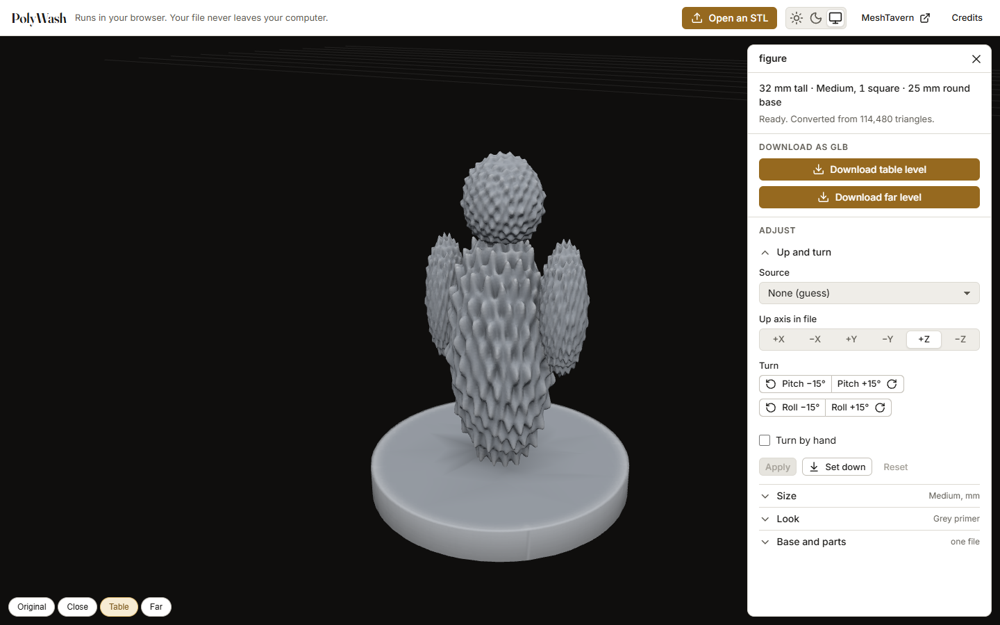

# PolyWash

An STL of a miniature in, a game-ready mini out. Everything runs in your browser: your file never leaves your computer.

<picture>
  <source media="(prefers-color-scheme: dark)" srcset="docs/design/look-and-feel/shots/readme-dark.png" />
  
</picture>

Drop the STL of a miniature you printed or bought. PolyWash stands it upright (and asks you first), measures it (units, base, creature size and its footprint on a 32 mm grid), reduces it to three detail levels, gives it a primed-and-washed look and hands you GLB files for a virtual tabletop. A figure and its base in two files, or a figure in up to six parts, are put together before anything else. The page follows your system's light or dark theme, or the switch in its bar.

**Open PolyWash:** the link goes here once the page is published. Until then, run it on your own computer as shown below.

PolyWash is made for MeshTavern, a virtual tabletop that is still being built; the table application uses this repository as its library. What the page ships and under which licences is under Credits on the page and in [`public/theme/NOTICE.txt`](public/theme/NOTICE.txt).

## Run it

```bash
npm install
npm run dev
```

Open the page, drop an STL (or choose one), and download the table or far level as a GLB. The team's tools from the spike (figures, stress scene, device benchmark, opening a GLB, the compressed download) appear with `?dev` in the address, for example `http://localhost:5173/?dev`.

## Develop

```bash
npm run check   # format, lint, typecheck, unit tests, build
npm run e2e     # Playwright smoke test (first time: npx playwright install chromium)
```

See [CONTRIBUTING.md](CONTRIBUTING.md) for the workflow and [CLAUDE.md](CLAUDE.md) for conventions (also used by the Claude Code agent).

Where it stands: usable end to end, not yet hosted. See [the Phase 0 spec](docs/specs/phase-0-spike.md) for measurements, and [the Phase 1 spec](docs/specs/phase-1-converter.md) for the converter at product quality and how its exit criteria ended: Phase 1 is finished, and what follows is what the table needs from the library and the release blockers. [The journal](docs/journal/) tells how it was built: what we tried, what failed and why.

## Use it as a library

The page is one consumer of the converter; the MeshTavern table application is another. `package.json` exports six entries, as TypeScript sources for a Vite project: `meshtavern-converter` (convert, refuse, size, orient, export, the painting's data and fill, the paint file; no three.js), `meshtavern-converter/three` (draw a baked mini), `meshtavern-converter/questions` (the view that asks a conversion's questions, with its stylesheet `meshtavern-converter/questions.css`), `meshtavern-converter/painting` (the view in which a person paints a baked mini, with its stylesheet `meshtavern-converter/painting.css`), `meshtavern-converter/painting-panel` (the painter's panel that drives that view, with its stylesheet `meshtavern-converter/painting-panel.css`) and `meshtavern-converter/dev` (generated meshes and STL writers, for tests and tooling). The package is not published to npm; install it from git (`"meshtavern-converter": "github:Tiarin-Hino/meshtavern-converter#<commit>"`).

```ts
import {
  Converter,
  ConversionProblem,
  PROBLEM_MESSAGES,
  readStlFile,
  memoryBudgetBytes,
  encodeGlb,
  DEFAULT_LOOK,
  BAKED_LEVEL,
  findSourcePreset,
} from 'meshtavern-converter';

const converter = new Converter();
// deviceMemory is Chromium-only; without it the budget assumes a 4 GB device.
const budget = memoryBudgetBytes((navigator as { deviceMemory?: number }).deviceMemory);

// A figure, and optionally its base and its other parts: up to MAX_PARTS files.
export async function addMini(files: File[]) {
  const [file, ...others] = files;
  try {
    // readStlFile refuses empty, not-STL and too-large files early.
    const [stl, secondStl, ...moreStl] = await Promise.all(
      files.map((f) => readStlFile(f, budget)),
    );
    const result = await converter.convert(
      stl!,
      (p) => console.log(p.step, p.percent),
      // sizing: or leave it out, suggested from the base; preset: the files' known export
      // convention, or leave it out, guessed; the other files are transferred too.
      {
        sizing: { size: 'medium' },
        preset: findSourcePreset('scene-m-y'),
        ...(secondStl && { secondStl, moreStl }),
      },
      // Optional: stop and ask on the full-detail meshes. askPerson and markPerson are your own
      // dialogs; answer with confirm: false to show a change first.
      async (question) =>
        question.kind === 'up'
          ? { kind: 'up', orientation: await askPerson(question), confirm: true }
          : { kind: 'meet', ...(await markPerson(question)), confirm: true },
    );
    // The level the table shows. When it was baked, result.baked has its unwrapped mesh, whose
    // texture coordinates go into the GLB as TEXCOORD_0, and the detail texture (ktx2) they are for.
    const table = result.baked?.mesh ?? result.lods[BAKED_LEVEL]!.mesh;
    const glb = encodeGlb(table, {
      name: file!.name,
      look: DEFAULT_LOOK,
      compact: false,
      sizing: result.sizing,
      orientation: result.orientation,
    });
    // Character or prop, guessed from the base; the `kind` option sets it.
    return { glb, ktx2: result.baked?.ktx2 ?? null, kind: result.kind.kind, stats: result.stats };
  } catch (error) {
    if (error instanceof ConversionProblem) console.warn(PROBLEM_MESSAGES[error.code]);
    throw error;
  }
}
// converter.cancel() stops the running conversion; its promise rejects with ConversionCancelled.
```

- The fourth argument of `convert` is optional. With it, the worker stops on the full-detail meshes and asks. Every `Question` carries the welded meshes the callback has not had yet (`meshes`, each file once, in file coordinates) and where to draw each file (`shown`: a rotation and a translation per file, and the `box` of it all). An `UpQuestion` (`kind: 'up'`) asks which way is up: the `role` (`mini`, or `base` then `figure` for several files), the proposed `orientation` and why (`reason`). The answer is an `UpAnswer`: `orientation` as in the options (`{}` is the proposal), `confirm`, and `swap` or `baseFile` (another file as the base, or `null`: no base, the files are parts of one figure). A `MeetQuestion` (`kind: 'meet'`) asks how a figure's parts go together (`about: 'parts'`, first) or where the figure meets its base (`about: 'base'`, last, for every pair), in two stages: `pairs` (the parts apart, with the pairs of patches where they meet: the converter's proposal, `proposed`, or the person's) and `fitted` (put together, `placement`). A patch is an area of a part's surface made by strokes (`Stroke`: a tap, a brush or an eraser dab at a point in its file's coordinates); a pair is a patch on the part in place (`on`) and one on the part that goes there (`of`). The answer is a `MeetAnswer` with one `action`: `tap` and `brush` (at a `Target`: a ray in the coordinates `shown` is drawn in, or a point on a file), `clear`, `undo`, `set` (a whole `Meeting` or the parts' joints at once), `fit` (put them together), `back`, `nudge` (`liftMm`, `turnDeg`, `turn: 'keep' | 'free'`), `pick` (what is there) and `confirm`. The question that comes back holds the marks (`marks`) and what to draw (`pairs`, each side's `triangles`). Without the callback nothing is asked, and the options say how the files stand and meet (`orientation`, `baseOrientation`, `pairing`, `parts`, `placement.marks`). `result.choices` holds what was confirmed: converting the same files with those options gives the same mini without asking.

- The questions can be asked by the view this page uses, instead of dialogs of your own: `mountQuestions` from `meshtavern-converter/questions` puts its own canvas into one element and its controls into another, draws every `Question` and sends every answer, so the consumer never looks inside one:

  ```ts
  import { mountQuestions } from 'meshtavern-converter/questions';
  // After the theme's stylesheets, linked in the page's <head> (see below).
  import 'meshtavern-converter/questions.css';

  // A dialog: a box for the meshes (give it a size), a box for the controls, your own Cancel.
  const view = mountQuestions({
    scene: dialog.querySelector<HTMLElement>('.scene')!,
    controls: dialog.querySelector<HTMLElement>('.controls')!,
    onChange: ({ question }) => dialog.classList.toggle('asking', question !== null),
  });
  cancelButton.onclick = () => converter.cancel();

  const ask = { up: true, baseUp: true, parts: true, meet: true };
  const askUp = view.start({ names: files.map((f) => f.name), ask });
  try {
    const result = await converter.convert(stl, onProgress, { secondStl, moreStl, ask }, askUp);
    // result.choices reproduces the mini without questions, as before.
  } finally {
    view.end();
  }
  ```

  `start` takes the files' names, what is asked, and the `orientation`, `baseOrientation` and `preset` id the conversion starts with, if any; it returns the callback for `convert`'s fourth argument. Left without `controls`, the view lays a panel of its own over the scene's right edge. Given a `footer` (a panel's footer that holds your Cancel), the view puts its Confirm there after what it holds, shown while its question is (#144); left out, Confirm ends the controls. The words are `QUESTION_COPY` and the sentence functions (`describeUp`, `describePairs`, …), replaced field by field: `mountQuestions({ copy: { askUp: 'Which way is up?' } })`. The controls are MeshTavern's components (#143): the page links the theme's `tokens.css` and `components.css` before the view's stylesheet, the table application's own (`web/public/theme/`) or the copy in this repo's `public/theme/` served with its `fonts/` folder, as this page does (`<link rel="stylesheet" href="/theme/tokens.css" />`, then `components.css`). Then `questions.css` is imported once, as above; it holds the view's layout and the few parts of its own the components do not have, every rule under `.mt-questions`, every colour a role of `tokens.css`, so the view follows the page's light or dark theme. Without the theme the controls work but have the browser's look. The chips' colours are `--pair-1` to `--pair-4`, which the view writes on its elements from `PAIR_COLOURS`. The view's elements keep this page's ids, so there is one view per document. `view.state` and the view's methods (`answerUp`, `confirmUp`, `tap`, `brush`, `confirmMeet`, …) are what this page's `window.__mt` hooks forward to, so `scripts/lib/answer-up.mjs` drives a consumer the same way.

- A source preset (`SOURCE_PRESETS`, `findSourcePreset(id)`, or a `SourcePreset` of your own) says what a tool's files are: `units`, an extra `scale` and the `up` axis. It lies under the options field by field: an `orientation`, `baseOrientation` or `sizing` given wins over it, and the converter guesses only what neither says. Its axis counts as chosen, so the up question still comes, standing the file the preset's way; an `UpAnswer` may set (`preset`) or clear (`preset: null`) it. `result.choices.preset` is the preset the conversion ended with.
- `result.kind` is a first guess whether the mini is a `character` or a `prop`, made from its base: a separate base file, no flat underside, or a bare flat top within `DISC_HEIGHT_MAX_MM` of the floor covering `TOP_SHARE` of the base make a character; anything else that stands on a flat underside is its own base, a prop (`reason` says which, `topShare` what was measured). The `kind` option sets it (`method: 'manual'`), and `result.choices.kind` keeps it. A tree on a disc reads as a character: the guess cannot tell it from a figure.
- The look is chosen when a mini is drawn and exported (`look` above, `vertexColours`, the `three` entry), not when it is converted: changing the colour does not need a new conversion. `LOOK_PRESETS` are named starting points (grey primer, bone, black drybrushed, steel, bronze), `presetOf(look)` says which one a look is, and a GLB written with a `sizing` records both in `extras.meshtavern.look`.
- `createBakedMaterial` and `transcodeDetail` from `meshtavern-converter/three` draw the baked table level with its KTX2 texture. `transcodeDetail` needs three.js's `basis_transcoder.js` and `.wasm` served; pass their folder as its third argument (this page serves them under `basis/`, see `vite.config.ts`).
- The look is per material: `createBakedMaterial(texture, uniforms)` reads the look from the `LookUniforms` it is given. Give each mini its own (`createLookUniforms(look)`, changed later with `updateLookUniforms`) when minis look different; pass one set to every material when they all look alike, as this page does, and one `updateLookUniforms` changes them all.
- A paint goes under the look (#125): `createBakedMaterial(texture, uniforms, { map })` takes a colour texture on the table level's texture coordinates (`result.baked.mesh`). It is laid out like the detail texture (row 0 at v = 0: `flipY` false) with its colour in sRGB (`colorSpace = SRGBColorSpace`) and straight alpha: where alpha is 1 the paint replaces the base coat, where it is 0 the base coat shows, in between the two mix; the wash still pools in the creases and the edges still catch the light. The far and close levels have no texture coordinates, so they take the paint per vertex, once: `paintAtVertices(level, result.baked.mesh, { width, height, data })` gives RGBA bytes per vertex (a vertex more than `PAINT_REACH_MM` from the table level stays bare), and `vertexColours(level, look, paint)` draws it under the same look. The texture stays the consumer's (not disposed with the material); spread a painted island's colour a few texels past its edge, as the bake does, or the smaller mipmaps mix the neighbouring islands of the atlas in at the seams.
- `renderThumbnail(mesh, { renderer, texture, albedo, look, size })` from `meshtavern-converter/three` makes the picture for a list of minis: the table level from the viewer's angle and light, a PNG `Blob` of at most `THUMBNAIL_SIZE` (512) px on a transparent background. It is made by the consumer after the conversion, not by the worker: pass the renderer that already draws the mini (it draws into a render target and leaves the screen alone; without one a private renderer is made and released), and, for a baked mini, `result.baked.mesh` with its transcoded texture (`transcodeDetail`) and its paint, if it has one (`albedo`, as `map` above), else `result.lods[BAKED_LEVEL].mesh`.
- A baked mini can be painted in a view of its own (#127, design note `docs/design/painting-engine.md`): `mountPainting` from `meshtavern-converter/painting` puts a canvas and a brush ring into one element; the panel (tools, sliders, palette, Undo, Redo, regions) is `meshtavern-converter/painting-panel`'s (the next bullet), or yours, wired to the view's methods. The strokes are written into a `PAINT_SIZE` (1,024) px colour texture over the table level's unwrap, drawn through `createBakedMaterial`'s `map`, so the paint comes back as an `Albedo` that `paintAtVertices` and `renderThumbnail` take:

  ```ts
  import { mountPainting } from 'meshtavern-converter/painting';
  // After the theme's tokens.css, as for the questions above.
  import 'meshtavern-converter/painting.css';
  import { groupsOf, regionsOf } from 'meshtavern-converter';

  const view = mountPainting({
    scene: dialog.querySelector<HTMLElement>('.scene')!,
    onChange: (state) => panel.render(state), // your tools, sliders, palette, Undo, Redo
  });
  const regions = regionsOf(result.baked!.mesh, {
    source: result.mesh,
    figureTriangles: result.pair?.figureTriangles,
    sizing: result.sizing,
    kind: result.kind,
  });
  await view.open({
    mesh: result.baked!.mesh,
    texture, // transcodeDetail(result.baked.ktx2, renderer)
    look,
    paint: storedPaint ?? null, // the Albedo you kept, or none
    mask: storedMask ?? null, // the PaintMask you kept, or none (#138)
    regions,
    // The PaintGroups you kept, or the automatic ones (#139): the base, the files, the shells.
    groups:
      storedGroups ??
      groupsOf(result.baked!.mesh, {
        regions,
        source: result.mesh,
        parts: result.pair?.parts,
        figureTriangles: result.pair?.figureTriangles,
      }),
  });
  view.setTool('flat');
  view.setBrush({ sizeMm: 2 });
  view.setColour('#b03030');
  // ... the person paints ...
  const albedo = await view.paint(); // 1,024² RGBA bytes: store them; paintAtVertices and renderThumbnail take them
  const mask = await view.mask(); // 1,024² bytes, 255 masked: store them beside the paint to go on later
  const groups = view.groups(); // a byte a triangle and how each group was made: store them too (#139)
  view.close();
  ```

  `open` refuses a mesh without texture coordinates (a mini whose bake was skipped) with a `RangeError` whose message is `PAINT_COPY.cannotPaint`. The left button, a pen's tip and one finger paint; the right button and two fingers turn the mini, the middle button pans, the wheel zooms; a second finger during a stroke cancels it; `setNavigating(true)` lets one finger turn the mini instead. A stroke reaches only what was in sight of the camera it was painted from and faces it, within a sphere of the brush's size in mm and no more than `BRUSH_DEPTH_MM` (1.5 mm) behind the dab along the line of sight (so a surface in sight across a gap, the back behind a hand, stays bare), and the gutter around every island of the atlas is filled two texels deep as it is painted, so no seam shows at full size; for mipmaps spread it further, as the paint bullet above says. The tools of this build are `flat`, `fill` (a tap fills the surface up to a fold or a crease, `brush.tolerance` loosening both; `fillRegion('base' | 'figure')` fills the ready regions `regionsOf` found), `eraser` (back to bare) and `lift` (#137: takes away the step the stroke starts on, wherever that step is still the top layer, and shows the paint beneath it; started again on the same spot it lifts the layer under that; its stroke records the step as `lifts`, and `state.lift` says which step it took, or why it took none: `nothing-painted` where no step since `open` changed the paint, `too-long-ago` where the step is older than the lift reaches (the last `UNDO_STEPS` steps), with `PAINT_COPY.lift` to say so), and the hobby brushes (#128), which read the mini's surface from the detail texture: `wash` pools in the creases and buried places, tints flat surface faintly and nearly leaves a raised edge (`opacity` is its strength); `ink` stains everything it covers, the creases most (`opacity` is its flow); `dry` catches the highest points under the brush where a stroke starts (its reference, the highest cavity under the first dab, measured on the GPU and again on every replay, #133) and anything as high along it, `opacity` its pressure, which reaches further down from them, and never paints flat surface or a crease (`toolMask`'s last parameter is the reference; `DRY_REFERENCE_MIN` is the lowest it counts as, `FLAT_CAVITY` where height is measured from); `airbrush` is soft and builds up over passes (`opacity` is its flow), and `brush.direction`, a vector in the mini's coordinates (scaled to unit length) (`[0, 1, 0]` is above), sprays only the surface that faces it: a zenithal highlight in one pass. The mask (#138) protects the surface from every tool, as liquid mask does on a real mini: where it is laid, no tool changes the paint (the lift included), and a fill treats it as a bound (a triangle whose middle the mask covers is never entered, so a band of mask two or three triangles wide across a wrist keeps a fill of the hand on the hand). It is made with `mask` (a brush that lays it, `opacity` how much), `unmask` (an eraser that takes it away) and `mask-fill` (a tap masks the surface up to a fold, a crease or the mask there; `maskRegion('base' | 'figure')` masks a ready region), and changed whole with `clearMask()` and `invertMask()` ("paint only the face"); each is one step of the history like a stroke (`MASK_TOOL_IDS`, `isMaskTool`; a `MaskChange` step for the last two). It is never in `paint()`: `mask()` gives it as a `PaintMask`, 1,024² bytes from 0 open to 255 masked, and `open` takes it back as `mask`. While a mini is open the view tints the masked surface blue (`MASK_TINT`); `setMaskShown(false)` hides the tint, and `state.maskShown` says which; `unmask-fill` (#139) takes the mask away from the surface a tap reaches. Groups (#139, design note `docs/design/paint-groups.md`) are sets of the table level's triangles, every triangle in one, group 0 the body: `groupsOf(table, { regions, source, parts, figureTriangles })` makes the automatic ones from what a conversion knows (the base from the ready regions or the base file, a group for every other file of a figure in parts, by the file under each triangle's middle, and every group's separate shells of at least `SHELL_MIN_TRIANGLES` (100) triangles, at most `MAX_GROUPS` (64)); give them to `open` as `groups` and keep what `groups()` gives (`PaintGroups`: `of`, a byte a triangle, and `made`, how each group came to be: `body`, `part`, `base`, `shell`, `hand`). `setGroupShown(k, false)` hides group k: it is drawn nowhere, takes no paint from any tool, and a tap or a stroke reaches the surface behind it, so the chest behind a shield can be painted; `showAllGroups()` brings every group back. Hiding is not a step and undo never shows a group, but each step records the groups hidden when it was made (`groups.hidden`, left out when none was), so a replay gives the same bytes whatever is hidden then. Groups are made by hand with `group` (a brush: the triangles whose middle its coverage reaches `GROUP_COVER` go into the target group, `setGroupTarget(k | 'new')`) and `group-fill` (a tap floods all that is connected within the group it starts in, up to the mask and the hidden groups, with no fold or crease bound: mask a wrist, tap the hand, and the hand is a group of its own); each is one step, `into` its target. `fillGroup(k)` and `maskGroup(k, masked)` fill or mask a group's triangles in one step (a `group` seed). `setGroupTint(true)` draws every group but 0 in its colour (`GROUP_COLOURS`), and while a group stroke is on the canvas its coverage shows in the target's colour; `state.groups` lists each group's origin and triangles, the hidden ones and the target, and `describeGroup(made, k, fileNames?)` names one for a panel ("The body", "Part 2", "Shell 2 of the body"). Groups can be pulled apart too (#180): `pullApart(k, offset)` draws group k moved by `offset` (mm along the mini's axes; without one, by the rule below for that group alone, clear of the groups already apart; it says whether the group is apart), where a tap or a stroke finds it and paints it alone (a dab on a pulled-apart arm leaves the shoulder bare, as it lies the gap away as drawn), `pullAllApart()` lays every group out as the parts question lays a figure's parts (`groupsApart`: group 0 stays, every other group moves along the line from the body by `APART_SHARE` of its largest side, at least `APART_MIN_GAP_MM`), and `putTogether()` brings them back; not steps either, but each step records the offsets at its start (`groups.apart`), so it replays to the same bytes with the groups together; a tap's point (`texelAt`) stays in the mini's own coordinates, and a fill never crosses from a group at one offset to another. `toolMask` gives each brush's share of a texel from the surface, and the constants it reads (`WASH_FLAT` … `AIR_DIR_SOFTNESS`) are exported beside it. Every stroke and fill is one step as plain JSON (`history()`), `undo` and `redo` reach back through every step since `open` by replaying from keyframes: within the last `UNDO_STEPS` (50) an undo replays at most nine steps; further back the first undo past them replays from the paint as opened (#165). A pipette is yours to draw too (#135): `colourAt(x, y, mode?)` gives the colour under a canvas point as `#rrggbb` for `setColour`, `'shown'` (the default, `PICK_MODE`) as the pixel on screen with the look's light and shading, `'painted'` as the paint's own colour in the texel there (null where that texel is bare), and null off the mini in either mode. The words are `PAINT_COPY`, replaced field by field, with a sentence or two on what each tool does (`toolHints`) for your panel and the pipette's words (`pick`), the mask's buttons (`mask`) and the groups' (`groups`); the view shows only `cannotPaint`. Every rule of the stylesheet is under `.mt-painting`; the ring takes the `--accent` role of the theme's `tokens.css`. Several views may share a document, one per element.

  What the view holds while a mini is open, over your own renderer's (a second WebGL context, like the question view's):

  | Target or texture                                    | Format                                       |                                              Size |
  | ---------------------------------------------------- | -------------------------------------------- | ------------------------------------------------: |
  | `atlas` (islands, borders, occlusion)                | RGBA8                                        |                                            4.0 MB |
  | `owner` (where each gutter texel's paint comes from) | RGBA8                                        |                                            4.0 MB |
  | `paint` (committed), `live` (on screen)              | RGBA8 sRGB, two                              |                                            8.0 MB |
  | `stroke` (the stroke's coverage)                     | R8, with a depth and stencil buffer          |                                            5.0 MB |
  | `stamp` (the newest step to change each texel, #137) | RG8                                          |                                            2.0 MB |
  | `mask` (committed), `maskLive` (on screen, #138)     | R8, two                                      |                                            2.0 MB |
  | `depth` (the stroke's camera)                        | 24-bit depth + R8, the drawing buffer's size |                           8.3 MB at 1,920 × 1,080 |
  | keyframes for undo, at most seven (#165)             | RGBA8 sRGB, RG8 and R8 (paint, stamp, mask)  |                                     up to 49.0 MB |
  | a keyframe for each step lift strokes took away      | RGBA8 sRGB, RG8 and R8                       |                                     7.0 MB a step |
  | the view's copy of the detail texture                | yours (compressed or raw)                    | 1.3 MB (1,024 px) to 5.3 MB (2,048 px) compressed |
  | the view's geometry (de-indexed, with groups, #139)  | 37 B a corner, three a triangle              |                        6.7 MB at 60,000 triangles |
  | the group map, live and in each keyframe (CPU)       | a byte a triangle                            |                              60 KB each at 60,000 |

  About 45 MB, 94 MB with every keyframe (and 7 MB more for each step lifted), plus the context's own canvas buffers (the drawing buffer is capped at 2 device pixels per CSS pixel). Measured on the development PC with the view open on large-01: the GPU process grew by 130 MB. `state.perf` is the view's frame counter for the last stroke (`performance.now()` around each frame, `slow` over `FRAME_BUDGET_MS`); it measures the CPU's part and what the GPU makes the CPU wait for, not GPU time, which needs `EXT_disjoint_timer_query_webgl2`. `scripts/measure-painting.mjs` also measures the time between frames.

- The painter's panel (#166, design note `docs/design/painting-panel.md`) is the sixth entry: `mountPaintingPanel` from `meshtavern-converter/painting-panel` fills one element with the panel's sections on MeshTavern's components and drives the view from them: the history row (Undo, Redo, Turn the mini), the tools with the tool's hint, the tool's sliders with each value in its label, the colour with the pipette and the swatches (the mini's colours, then yours), the regions, the mask, the groups as rows (Hide and Pull apart beside each) and the look. It holds no state of its own: it reads `view.state` through `subscribe` (your `onChange` stays yours), so a change made by your code shows in the panel too. Your frame's header and footer stay yours: the page puts Save and Open beside it, the application its dialog's Close and Save, as `docs/design/look-and-feel/app-painting.html` draws it:

  ```ts
  import { mountPainting } from 'meshtavern-converter/painting';
  import { mountPaintingPanel } from 'meshtavern-converter/painting-panel';
  // After the theme's tokens.css and components.css.
  import 'meshtavern-converter/painting.css';
  import 'meshtavern-converter/painting-panel.css';

  const view = mountPainting({ scene: dialog.querySelector<HTMLElement>('.mt-painting')!, copy });
  const panel = mountPaintingPanel({
    view,
    controls: dialog.querySelector<HTMLElement>('.paint-panel .panel-body')!, // a .panel-body.flush
    copy, // the same words as the view's
    palette: accountColours, // your colours, after the mini's own
    names: fileNames, // a part's group is named after its file
  });
  // Later: panel.setPalette(…) when your colours change; panel.dispose() before the view's.
  ```

  The view gained what a panel outside it needs: `subscribe(listener)` (after `onChange`, until the function it returns is called), `state.look` (the look the mini is drawn with, `setLook`'s after `open`) and `pickColour(mode?)`, which waits for the next tap on the canvas and resolves with `colourAt` there, painting nothing (`state.picking` while it waits, the host's class `mt-painting-picking` with a crosshair; null for a tap off the mini; `cancelPick()`, closing and a second pick end it without a tap, resolving undefined). The words are `PAINT_COPY`'s, with `panel`, `directions` and `look` for the sections, replaced field by field; `SLIDERS`, `DIRECTIONS`, `panelSwatches` and `sliderValue` are the tables and functions it writes with. Every rule of its stylesheet is under `.mt-painting-panel` and reads the theme's roles; every element a test or your code reaches has a `data-` attribute, no id, so two panels may share a document.

- A painting is saved as a **paint file** (#165, design note `docs/design/painting-engine.md` §17): what made it, not its pixels. It holds the converter's version (`CONVERTER_VERSION`), the file's own (`PAINT_FILE_VERSION`), the engine each step was painted on (`engines`, `PAINT_ENGINE_VERSION`), a fingerprint of every file the mini was converted from (SHA-256, size and its role: `figure`, `part` or `base`), the conversion's choices, the look and the steps as `history()` records them; no geometry, no texture, no file names. It is JSON with the extension `PAINT_FILE_EXTENSION` (`.mtpaint`), gzip-compressed above `PAINT_FILE_GZIP_ABOVE` (1 MiB); a long session is a few hundred KiB. Everything but the view is in `meshtavern-converter`, without three.js or the DOM:

  ```ts
  import {
    convertOptionsOf,
    fingerprintSources,
    matchSources,
    paintedOnOlderEngine,
    readPaintFile,
    sourceRoles,
    writePaintFile,
  } from 'meshtavern-converter';
  import { PAINT_COPY } from 'meshtavern-converter/painting';

  // Save: fingerprint the files before `convert` takes them (it transfers their buffers).
  const sources = await fingerprintSources(stls, sourceRoles(result.pair, stls.length));
  const bytes = await writePaintFile({
    sources,
    choices: { ...result.choices, sizing }, // the sizing you converted with
    look,
    steps: view.history(),
    engines: view.engines(),
  });

  // Open: refused before anything converts when the files are not the ones it names, as a
  // ConversionProblem whose message says which file is missing or different.
  const file = await readPaintFile(dropped); // ConversionProblem 'not-a-paint-file' or 'paint-file-newer'
  const [stl, secondStl, ...moreStl] = await matchSources(file, droppedStls);
  const again = await converter.convert(stl, onProgress, {
    ...convertOptionsOf(file), // no question: the choices as the file says
    secondStl,
    moreStl,
  });
  if (paintedOnOlderEngine(file)) showLine(PAINT_COPY.olderEngine);
  await view.open({
    mesh,
    texture,
    look: file.look,
    regions,
    groups,
    steps: file.steps,
    engines: file.engines,
  });
  ```

  `open` replays the steps over the paint, mask and groups it is given, exactly as undo replays them, and opens at the end of them with undo back through all of them; steps that cannot be the mesh's (a triangle it does not have, a ready region it has none of) are refused with a `RangeError` before anything opens. On the same engine version and device the paint, mask and groups are the same bytes as when the painting was saved (`e2e/paint-file.spec.ts`). A file painted on an older engine replays as it was painted: a brush change that would alter old paintings keeps the old behaviour for steps of an older engine (`engineOf`), and `paintedOnOlderEngine` says when to show `PAINT_COPY.olderEngine`; a file of a newer engine or file version is refused (`paint-file-newer`). A recorded painting of the generated figure (`src/regression/painting.mtpaint`) is replayed and compared in every e2e run.

- Linked with `file:../meshtavern-converter` instead, Vite's dev server refuses to serve the worker from outside the project until the folder is allowed: `server: { fs: { allow: ['.', '../meshtavern-converter'] } }`.

## Licence

[MIT](LICENSE).

## Third-party content

The unwrap runs [xatlas](https://github.com/jpcy/xatlas) (MIT, Copyright 2018-2020 Jonathan Young), compiled by this project to WebAssembly from upstream commit `f700c779` (`wasm/xatlas/`, licence in [`wasm/xatlas/LICENSE`](wasm/xatlas/LICENSE)).

The detail texture is encoded with [Basis Universal](https://github.com/BinomialLLC/basis_universal) (Apache-2.0, Copyright 2016–2026 Binomial LLC; "Basis Universal" is a trademark of Binomial LLC), compiled by this project to WebAssembly from upstream commit `1b33fd50` (`wasm/basis-encoder/`, licence and notice in [`wasm/basis-encoder/LICENSE`](wasm/basis-encoder/LICENSE) and [`wasm/basis-encoder/NOTICE`](wasm/basis-encoder/NOTICE)). The build includes [Zstandard](https://github.com/facebook/zstd) (BSD-3-Clause, Copyright Meta Platforms, Inc., [`wasm/basis-encoder/LICENSE-zstd`](wasm/basis-encoder/LICENSE-zstd)) and the QOI and DDS readers upstream bundles (MIT, [`wasm/basis-encoder/LICENSE-mit`](wasm/basis-encoder/LICENSE-mit)).

The source presets (`src/lib/pipeline/source-preset.ts`) cite where each convention is documented: PrusaSlicer's [source](https://github.com/prusa3d/PrusaSlicer/tree/version_2.8.1) for millimetres and Z (PrusaSlicer is a trademark of Prusa Research a.s.), Blender's [source](https://github.com/blender/blender/tree/v4.2.0) for its STL export defaults and scene units (Blender is a trademark of the Blender Foundation), and the [glTF 2.0 specification](https://registry.khronos.org/glTF/specs/2.0/glTF-2.0.html#coordinate-system-and-units) for metres and +Y up (glTF is a trademark of The Khronos Group Inc.). The presets' labels name the convention, not the tool; no tool endorses this project.

The creature size names (Tiny, Small, Medium, Large, Huge, Gargantuan, in `src/lib/pipeline/size.ts`) come from the SRD 5.1. The footprint in squares, the 32 mm grid and the plain-base diameters are this project's own.

This work includes material taken from the System Reference Document 5.1 ("SRD 5.1") by Wizards of the Coast LLC and available at <https://dnd.wizards.com/resources/systems-reference-document>. The SRD 5.1 is licensed under the Creative Commons Attribution 4.0 International License available at <https://creativecommons.org/licenses/by/4.0/legalcode>.
